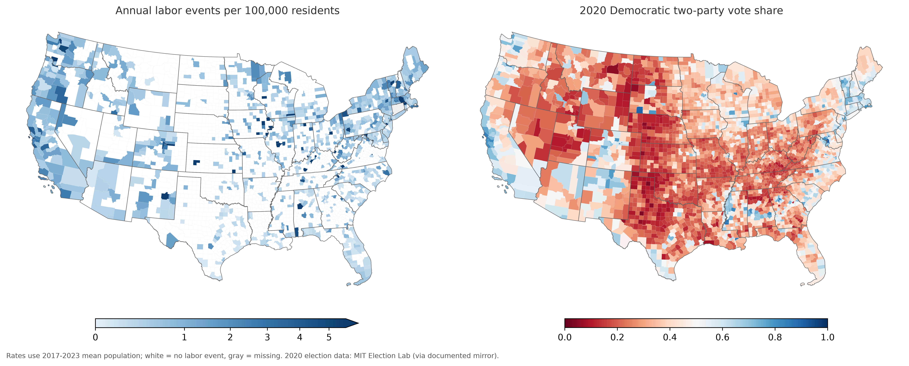
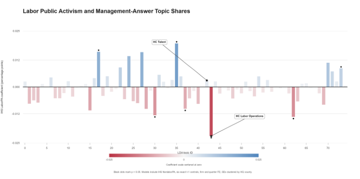
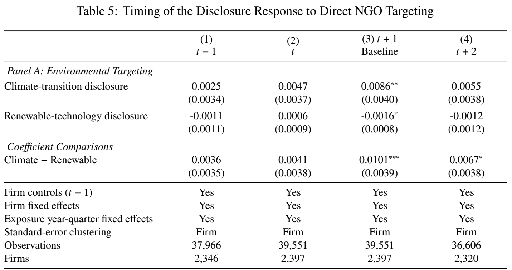
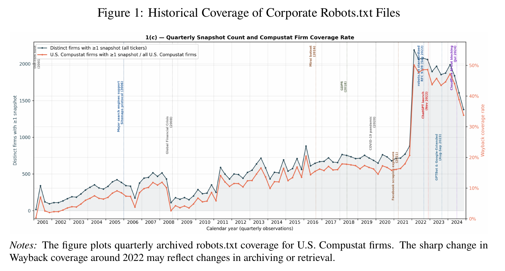
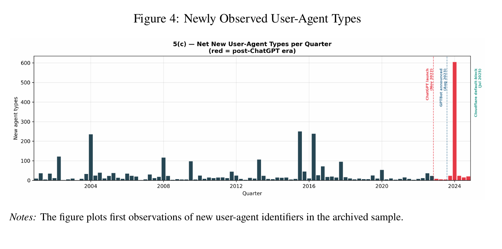

<header class="page-heading">
  
Research agenda

  <h1>Research</h1>
  
Across these projects, I examine how stakeholders and technology shape what firms disclose, how corporate information is used, and how firms govern access to it.

</header>

<section class="academic-section" aria-labelledby="working-papers">
  

    <h2 id="working-papers">Working Papers</h2>
  

  <article class="research-paper research-paper--featured" id="job-market-paper">
    
Job Market Paper

    <h3>Public Activism and Labor-Related Corporate Disclosure</h3>
    
Single-authored

    
Working paper &middot; October 2026 draft

    
<strong>Award</strong> The Sue Hrasky Best PhD Paper Prize, BAFA, 2026.

    
How does local public activism influence corporate disclosure when it does not directly target the firm?

    
Greater non-firm-specific labor activism in a firm's headquarters county is associated with less discussion of current labor operating conditions relative to talent-management information in subsequent earnings calls.

    

      <a href="../assets/job-market-paper.pdf">Paper (PDF) &rarr;</a>
      <a href="#job-market-abstract">Abstract &rarr;</a>
    

    

      <h4>Abstract</h4>
      
This paper examines whether public activism is relevant to corporate disclosure even when the underlying public activity is not directly targeted at the focal firm. Using non-firm-specific labor-related public activism in the same county as firms' headquarters, I find that greater local public activism is associated with less discussion of current labor-related operating conditions relative to talent-management information in subsequent earnings calls. Consistent with the potential informational relevance of public activism, the association is more pronounced when public activism has greater attention-generating potential and varies with the relevance and reach of surrounding audiences. The findings suggest that information about the current prominence of stakeholder concerns may be relevant to firms' disclosure choices, even without direct firm-specific activist pressure. More broadly, they highlight how the potential consequences of investor-facing disclosure may vary with issue prominence and the relevance of broader audiences.

    

    

      <h4 id="job-market-figures">Selected Figures</h4>
      

        <figure class="paper-figure">
          
          <figcaption><strong>Labor-related public activism.</strong> Annual events per 100,000 residents by U.S. county, 2017–2023. The linked full figure also shows 2020 vote share.</figcaption>
        </figure>
        <figure class="paper-figure">
          
          <figcaption><strong>Topic-level associations.</strong> LaborPA coefficients across 75 earnings-call topics; HC Labor Operations has the most negative coefficient.</figcaption>
        </figure>
      

    

    

      
<strong>Selected presentations</strong> EAA Doctoral Colloquium 2026; IESE Seminar 2026; BAFA Annual Conference 2026; JIAR Annual Conference 2026; University of Zurich DAR Workshop 2025.

    

  </article>

  <article class="research-paper" id="ngo-activism">
    
Working paper

    <h3>Corporate Responses to NGO Activism: Disclosure and Labor Demand</h3>
    
With <a href="https://www.simondzxu.com/home">Simon Xu</a> (Stanford)

    
Working paper &middot; October 2026 draft

    
How is environmental NGO targeting related to climate-transition disclosure and firms' demand for green-technology workers?

    
Environmental targeting is associated with more managerial disclosure about climate-transition topics relative to renewable-energy technologies, and with lower subsequent demand for specialized green-technology workers but not environmental compliance workers.

    

      <a href="../assets/ngo-activism-paper.pdf">Paper (PDF) &rarr;</a>
      <a href="#ngo-abstract">Abstract &rarr;</a>
    

    

      <h4>Abstract</h4>
      
We examine how nongovernmental organization (NGO) activism relates to corporate disclosure and substantive responses. Using firm-specific NGO targeting events, earnings-call transcripts, and job-posting data in the United States from 2017 to 2023, we find that environmental targeting is associated with increased managerial disclosure about climate-transition topics relative to renewable-energy technologies. In contrast, environmental targeting is associated with lower subsequent demand for specialized green-technology workers, but not environmental compliance workers. These findings highlight how firms' near-term communication and subsequent demand for specialized technological labor can respond differently to NGO scrutiny.

    

    <figure class="paper-figure ngo-table-figure" id="ngo-table-5">
      
      <figcaption><a href="../assets/ngo-activism-paper.pdf#page=42">Full Table 5 and notes (PDF, p. 41)</a></figcaption>
    </figure>
  </article>

  <article class="research-paper" id="automated-access">
    
Working paper

    <h3>How Firms Govern Automated Access to Corporate Information: Evidence from Robots.txt</h3>
    
With <a href="https://www.iese.edu/phd-in-management/students/long-cheng/">Long Cheng</a> (IESE) and <a href="https://www.iese.edu/faculty-research/faculty/igor-kadach/">Igor Kadach</a> (IESE)

    
Working paper &middot; November 2026 draft

    
How do firms govern automated access to publicly available corporate information?

    
General access restrictions are widespread in archived robots.txt records. Historical crawler-specific policies are associated with later restrictions on newly introduced AI-related identifiers, though the evidence is less conclusive under stricter comparisons.

    

      <a href="../assets/automated-access-paper.pdf">Paper (PDF) &rarr;</a>
      <a href="#automated-access-abstract">Abstract &rarr;</a>
    

    

      <h4>Abstract</h4>
      
We examine how publicly traded firms govern automated access to publicly available corporate information. Using historical robots.txt records for 5,877 U.S. firms from 2001 to 2024, we document substantial variation in the scope of access restrictions and the treatment of individual web crawlers. We find that general access restrictions are widespread, while crawler-specific restrictions are less common. Website software explains part of this variation, but historical crawler-specific policies also predict subsequent restrictions on newly introduced AI-related identifiers. This association is concentrated in changes involving named crawlers rather than general website-access rules, although the evidence is less conclusive under stricter comparisons. Our findings identify automated information access as a distinct dimension of corporate information policy, extending beyond firms' decisions about what information to disclose.

    

    

      <h4 id="automated-access-figures">Selected Figures</h4>
      

        <figure class="paper-figure">
          
          <figcaption><strong>Figure 1. Historical coverage of corporate robots.txt files.</strong></figcaption>
        </figure>
        <figure class="paper-figure">
          
          <figcaption><strong>Figure 4. Newly observed user-agent types.</strong></figcaption>
        </figure>
      

    

    

<strong>Presentation</strong> REAP Workshop.

  </article>
</section>

<section class="academic-section" aria-labelledby="work-in-progress">
  <h2 id="work-in-progress">Work in Progress</h2>
  <article class="research-paper" id="data-licensing">
    <h3>From Open Access to Data Licensing: Legal Protection and the Monetization of Corporate Information</h3>
    
With <a href="https://www.iese.edu/phd-in-management/students/long-cheng/">Long Cheng</a> (IESE)

    
How do legal protection and data value shape firms' choices between open access and data licensing?

    

      <h4>Abstract</h4>
      
This project examines how legal protection shapes firms' ability to capture the economic value of publicly available information. While corporate data may be valuable to third-party information intermediaries, firms' ability to monetize such data depends partly on their capacity to restrict unauthorized collection and reuse. The study investigates how legal protection and data value jointly influence firms' choices among open access, contractual restrictions, and commercial data licensing. It further explores whether these governance mechanisms affect firms' incentives to produce and disseminate information.

    

  </article>
</section>

<section class="research-more" aria-labelledby="published-work">
  <h2 id="published-work">Published Work</h2>
  
<a href="../publications/">Same Interdependent Risk, Different Valuation: How Risk Representation Shapes Ecosystem Investment Decisions</a> Journal of Management Scientific Reports, 2026

  <a class="text-link" href="../publications/">Publication details &rarr;</a>
</section>
